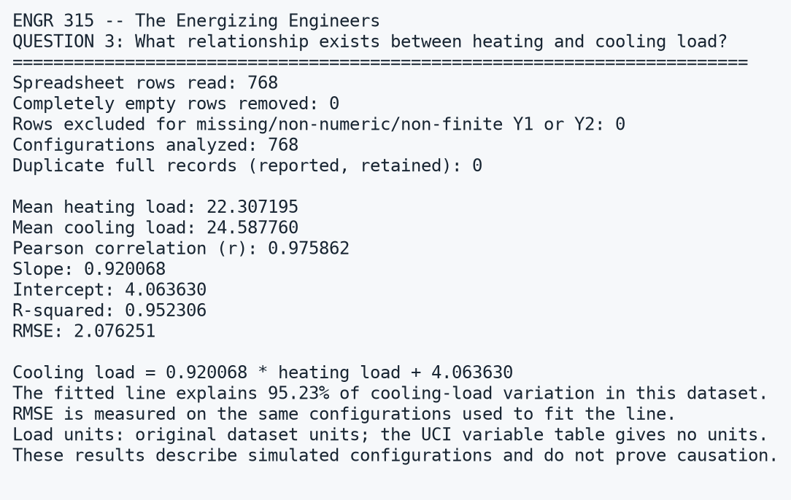
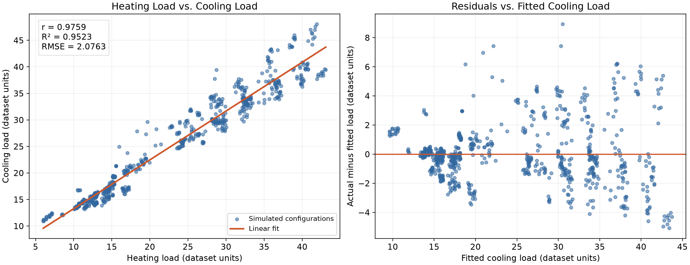

# How Building Design Affects Energy Efficiency

**Course:** JMU ENGR 315 — Computational Methods in Engineering  
**Team:** The Energizing Engineers

**Contributors:**
- Wyatt Price
- Bryson Vaughan
- Luke Cianciotti

## Objective and Motivation

Our project investigates how building design relates to the energy needed for heating and cooling. Engineers make many decisions about building shape, height, orientation, and window area. We want to understand how these features relate to heating and cooling requirements and which relationships could help guide more energy-efficient designs.

We will use Python to organize the data, calculate statistics, perform data fitting, and create plots that answer three selected research questions.

## Dataset

We are using the **Energy Efficiency** dataset created by Athanasios Tsanas and Angeliki Xifara and published through the UCI Machine Learning Repository.

The researchers used Ecotect software to simulate 768 building configurations based on 12 basic building shapes. These configurations vary in their design features and corresponding heating and cooling loads.

The dataset contains eight input variables and two output variables:

| Column | Variable |
|---|---|
| X1 | Relative compactness |
| X2 | Surface area |
| X3 | Wall area |
| X4 | Roof area |
| X5 | Overall height |
| X6 | Orientation |
| X7 | Glazing area |
| X8 | Glazing area distribution |
| Y1 | Heating load |
| Y2 | Cooling load |

The dataset contains 768 complete rows. In Phase II, the Question 3 script verified that all 768 heating/cooling pairs are numeric and finite, with no rows excluded.

**Dataset and download:**  
https://archive.ics.uci.edu/dataset/242/energy+efficiency

The source file is available in Excel format. We will read it directly with Python or convert it to CSV if needed.

## Research Questions and Expected Answers

### Question 1
**How does overall building height affect heating load when considering the building's surface area?**

We will compare heating loads between height groups and examine the relationship between surface area and heating load within those groups.

**Expected answer format:** A table of group statistics, a comparison of mean heating loads, and plots showing heating load against surface area for each height group.

**Potential benefit:** Help explain how building height and exposed surface area relate to heating requirements.

### Question 2
**How does glazing affect cooling load across different building orientations?**

We will compare cooling loads across glazing areas and orientations and fit models describing these relationships.

**Expected answer format:** Group averages, fitted equations for each orientation, measures of fit quality, and plots comparing the relationships.

**Potential benefit:** Help identify how window area and orientation relate to cooling requirements.

### Question 3
**What relationship exists between heating load and cooling load?**

We will determine whether simulated buildings with higher heating loads also tend to have higher cooling loads.

**Expected answer format:** A correlation coefficient, a fitted linear equation, an R-squared value, and a scatterplot with a fitted line.

**Potential benefit:** Help explain whether heating and cooling requirements tend to increase together.

## Introduction and Context

Heating load and cooling load represent the heating and cooling requirements of the simulated building configurations.

This dataset contains simulated designs rather than measurements from occupied buildings. Our conclusions will describe relationships within these simulations. We will avoid claiming that a single design feature independently causes a change in energy use.

## Implementation Details

### Data Preparation

Before answering the questions, we will:

1. Load the dataset using pandas.
2. Check the column names, data types, and number of rows.
3. Remove empty spreadsheet rows or columns if present.
4. Check for missing values and duplicate configurations before deciding whether any records should be removed.
5. Rename columns with descriptive names to make the code easier to understand.
6. Confirm variable units and category meanings using the dataset documentation.
7. Group and filter the data as needed for each question.
8. Document any changes so the analysis can be reproduced.

### Question 1: Height, Surface Area, and Heating Load

**Variables:**
- X5: Overall height
- X2: Surface area
- Y1: Heating load

**Methods:**
- Group the building configurations by overall height.
- Calculate heating-load statistics for each height group.
- Group by both height and surface area to examine how heating load varies across the available combinations.
- Plot heating load against surface area, distinguishing the height groups.
- Use a two-sided Welch's t-test as an exploratory comparison of mean heating loads between the two height groups.

**Statistical hypotheses:**
- Null hypothesis: The two height groups have equal mean heating loads.
- Alternative hypothesis: The two height groups have different mean heating loads.
- Significance level: 0.05.

**Metrics:**
- Number of configurations in each group
- Mean heating load
- Standard deviation
- Difference between group means
- t-statistic and p-value

**Tools:**
- pandas for filtering and grouping
- NumPy for numerical calculations
- SciPy for Welch's t-test
- Matplotlib for plotting

**Plots:**
- Boxplot of heating load by building height
- Scatterplot of surface area versus heating load, colored by height

**Interpretation limits:**
The height-group t-test does not control for surface area or other design variables. We will check which surface-area values occur within each height group and avoid interpreting the group difference as the independent effect of height. Repeated configurations based on the same building shapes also limit the independence of observations, so the test will be interpreted cautiously.

### Question 2: Glazing, Orientation, and Cooling Load

**Variables:**
- X7: Glazing area
- X6: Orientation
- Y2: Cooling load

**Methods:**
- Group the data by glazing area and orientation.
- Calculate the mean and standard deviation of cooling load for each combination.
- Fit a linear relationship between glazing area and cooling load separately for each orientation.
- Compare the fitted slopes and fit quality across orientations.
- Inspect residuals to assess whether a straight-line model adequately describes the relationship.

**Metrics:**
- Mean cooling load for each glazing-area and orientation combination
- Standard deviation and group counts
- Fitted slope and intercept for each orientation
- R-squared
- Root mean squared error

**Tools:**
- pandas for grouping and summaries
- NumPy for error calculations
- SciPy for linear regression
- Matplotlib for plots

**Plots:**
- Mean cooling load versus glazing area, with a separate line for each orientation
- Scatterplots with fitted regression lines
- Residual plots to check model fit

**Interpretation limits:**
Other building features also vary across the dataset. These comparisons describe the available configurations and will not establish an independent causal effect of glazing or orientation.

### Question 3: Heating Load and Cooling Load

**Variables:**
- Y1: Heating load
- Y2: Cooling load

**Methods:**
- Create a scatterplot with heating load on the horizontal axis and cooling load on the vertical axis.
- Calculate Pearson's correlation coefficient.
- Fit a linear model predicting cooling load from heating load.
- Evaluate the model using R-squared, root mean squared error, and residual plots.

**Model form:**

Cooling load = slope × heating load + intercept

**Metrics:**
- Pearson correlation coefficient
- Fitted slope and intercept
- R-squared
- Root mean squared error

**Tools:**
- pandas for selecting data
- NumPy for numerical calculations
- SciPy for correlation and linear regression
- Matplotlib for plotting

**Plots:**
- Scatterplot of heating load versus cooling load with a fitted line
- Residual plot

**Interpretation limits:**
A correlation between heating and cooling loads does not mean that one causes the other. Both may be related to shared building-design features.

### Planned Python Packages

- **pandas:** Read, clean, filter, and group the dataset.
- **NumPy:** Perform numerical calculations.
- **SciPy:** Perform statistical tests, correlation analysis, and linear regression.
- **Matplotlib:** Create labeled figures.
- **openpyxl:** Support reading the original Excel file if needed.

At least two research questions will use statistical analysis or data fitting, as required by the project instructions.

## Phase II Progress

Question 3 has been implemented and run on all 768 configurations. Questions 1 and 2 remain planned work. This phase completes one question/method pair using correlation and linear data fitting.

## Running the Question 3 Analysis

Use Python 3 with the packages listed in `requirements.txt`. From a terminal in the repository folder, run:

```bash
python -m pip install -r requirements.txt
python question3_analysis.py
```

The script locates the dataset relative to its own location, so it does not require a computer-specific file path. No dataset download is needed when the provided `data` folder is present.

Required files:
- `question3_analysis.py`: loads the data, calculates metrics, prints answers, and saves outputs.
- `requirements.txt`: required Python packages.
- `data/ENB2012_data.xlsx`: original UCI dataset, shared under CC BY 4.0 with attribution below.

Generated files:
- `results/question3_output.txt`: exact printed analysis report.
- `results/question3_output.png`: image of that printed report.
- `results/question3_plots.png`: scatterplot with fitted line and residual plot.
- `results/question3_predictions.csv`: observed loads, fitted cooling loads, and residuals.

Open the PNG files to view the graphs, or run `python question3_analysis.py --show` to open the saved plot in an image viewer.

### Implemented Method

The script reads Y1 (heating load) and Y2 (cooling load), checks that both columns exist, and checks the values for missing, non-numeric, or non-finite entries. It retains repeated load pairs because different configurations can have the same loads. It also reports duplicate full records. No rows needed removal in this run, and no duplicate full records were found.

SciPy's `linregress` fits cooling load as a linear function of heating load and provides the Pearson correlation coefficient. NumPy calculates residuals, R-squared, and root mean squared error. Matplotlib creates the plots.

The UCI variable table does not specify units for heating and cooling loads. Accordingly, outputs use original dataset units rather than assuming a physical unit.

## Results (Answers to the Questions)

### Question 3: What relationship exists between heating load and cooling load?

| Metric | Result |
|---|---:|
| Configurations analyzed | 768 |
| Mean heating load | 22.307195 |
| Mean cooling load | 24.587760 |
| Pearson correlation, r | 0.975862 |
| Fitted slope | 0.920068 |
| Fitted intercept | 4.063630 |
| R-squared | 0.952306 |
| RMSE, dataset load units | 2.076251 |

The fitted equation is:

**Cooling load = 0.920068 × heating load + 4.063630**

There is a strong positive linear relationship between heating and cooling loads in the simulated configurations. The fitted line accounts for approximately 95.23% of the observed variation in cooling load. A one-unit increase in heating load corresponds to an increase of about 0.9201 units in fitted cooling load.

The RMSE is approximately 2.0763 dataset load units. This is the error on the same configurations used to fit the model; it is not a test of prediction accuracy on new buildings.

### Printed Analysis Output



[View the complete text output](results/question3_output.txt)

### Question 3 Plots



The scatterplot shows the strong upward relationship. The residuals show structure and changing spread rather than a completely random cloud around zero. A single line summarizes the overall relationship well but does not capture all variation between building configurations.

### Questions 1 and 2

Analyses of height/surface area and glazing/orientation are planned for the next stage. No final results are reported for these questions yet.

## Conclusions

For Question 3, configurations with higher heating loads generally also have higher cooling loads. This supports our expected positive relationship. The correlation of 0.975862 and R-squared of 0.952306 show that a straight line provides a strong overall summary of this dataset.

However, the residual pattern shows that the relationship is not fully described by a single line. Both loads may respond to common building-design features. These results describe simulated configurations, do not establish causation, and do not demonstrate performance on measured or unseen buildings.

## Actions that need to be completed

- [x] Include the original dataset with its source and attribution.
- [x] Check the Question 3 load columns for invalid values.
- [x] Implement and run Question 3 correlation and linear fitting.
- [x] Print and save the calculated metrics.
- [x] Generate the fitted-line plot and residual plot.
- [x] Document Question 3 results, conclusions, and limitations.
- [x] Add installation and execution instructions.
- [ ] Confirm every teammate has accepted their collaborator invitation.
- [ ] Review and address instructor feedback.
- [ ] Complete Question 1: height, surface area, and heating load.
- [ ] Complete Question 2: glazing, orientation, and cooling load.
- [ ] Check statistical assumptions for the remaining analyses.
- [ ] Have another teammate reproduce the results after downloading the repo.
- [ ] Complete final conclusions across all three questions.
- [ ] Prepare the final presentation and demonstration.

**Current limitation:** The Question 3 residual plot shows structure not captured by a simple linear fit. We will discuss this limitation when interpreting our final results.

## References/Source Files

1. Tsanas, A., & Xifara, A. (2012). *Energy Efficiency*. UCI Machine Learning Repository. https://doi.org/10.24432/C51307

2. Energy Efficiency dataset and download:
   https://archive.ics.uci.edu/dataset/242/energy+efficiency

3. The Energizing Engineers. *How Building Design Affects Energy Efficiency*. ENGR 315 Phase 0 Project Proposal, James Madison University.

4. JMU ENGR 315 Project Description and Phase I and Phase II assignment instructions.

5. Dataset license: Creative Commons Attribution 4.0 International (CC BY 4.0). https://creativecommons.org/licenses/by/4.0/
